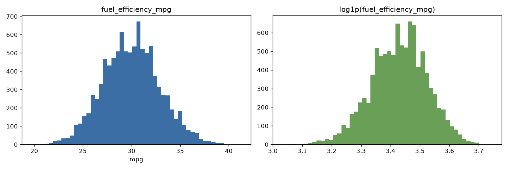
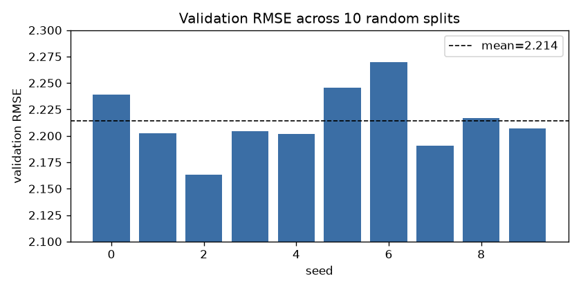

# When Ridge Regression Makes Your Model Worse: Linear Regression from Scratch on 10,000 Cars

*Subtitle: ML Zoomcamp 2026, Module 2. Normal equation, imputation leakage, seed stability, and why you shouldn't regularize the intercept.*

*Suggested Medium tags: Machine Learning, Linear Regression, Data Science, Python, Mlzoomcamp*

---

The second module of [DataTalks.Club's ML Zoomcamp](https://github.com/DataTalksClub/machine-learning-zoomcamp) has you implement linear regression with nothing but NumPy. There's no `sklearn.linear_model`, just matrix algebra. The 2026 homework applies it to a synthetic but realistic car dataset, with the task of predicting fuel efficiency in miles per gallon.

Most of the homework went as expected. One result didn't: **adding ridge regularization made the model strictly worse**. Tracing down why turned out to be the most useful thing I learned this week, and it applies directly to production ML code.

All code is on GitHub: [devotuoma/machine-learning-zoomcamp · 02-regression/solution](https://github.com/devotuoma/machine-learning-zoomcamp/tree/main/cohorts/2026/homework/02-regression/solution)

---

## 1. The data

The dataset has 10,000 cars and 11 columns. The homework restricts us to four numeric features and the target:

```python
base = ['engine_displacement', 'horsepower', 'vehicle_weight', 'model_year']
target = 'fuel_efficiency_mpg'
df = pd.read_csv('car_fuel_efficiency_2026.csv')[base + [target]]
```

| feature | mean | std |
|---|---|---|
| engine_displacement | 2,268.8 | 183.4 |
| horsepower | 254.4 | 22.8 |
| vehicle_weight | 4,286.8 | 266.2 |
| model_year | 1,999.5 | 14.2 |
| **fuel_efficiency_mpg** | **30.0** | **2.93** |

Note the scales. `vehicle_weight` and `model_year` are in the thousands, while the target is around 30. That matters later.

### Does the target have a long tail?



No. Skewness is 0.081, and mean (29.998) ≈ median (30.0). The distribution is roughly bell-shaped between 20 and 41 mpg. In the lectures' car-price problem, `log1p` was essential because prices are heavily right-skewed. Here a log transform would only add complexity, so I left the target as is.

**Lesson:** look at your target before reaching for transforms by habit.

---

## 2. Missing values (Q1, Q2)

```python
df.isnull().sum()
# engine_displacement      0
# horsepower             877
# vehicle_weight           0
# model_year               0
```

`horsepower` is the only column with missing values: 877 rows, 8.77%. Its median is **254**.

---

## 3. A reproducible 60/20/20 split

The lecture uses a manual shuffle-and-slice split, which you need to reproduce exactly to match the expected answers:

```python
def split(df, seed):
    n = len(df)
    n_val = n_test = int(n * 0.2)
    n_train = n - n_val - n_test
    np.random.seed(seed)
    idx = np.arange(n)
    np.random.shuffle(idx)
    return (df.iloc[idx[:n_train]].reset_index(drop=True),
            df.iloc[idx[n_train:n_train + n_val]].reset_index(drop=True),
            df.iloc[idx[n_train + n_val:]].reset_index(drop=True))
```

This gives 6,000 / 2,000 / 2,000 rows.

---

## 4. Linear regression from scratch

We want weights $w$ that minimize $\|Xw - y\|^2$. Setting the gradient to zero gives the **normal equation**:

$$
w = (X^\top X)^{-1} X^\top y
$$

To learn a bias term, we prepend a column of ones to $X$:

```python
def train_linear_regression(X, y):
    X = np.column_stack([np.ones(X.shape[0]), X])
    XTX = X.T.dot(X)
    w_full = np.linalg.inv(XTX).dot(X.T).dot(y)
    return w_full[0], w_full[1:]

def rmse(y, y_pred):
    return np.sqrt(((y - y_pred) ** 2).mean())
```

(In production you'd use `np.linalg.solve` or `lstsq` rather than an explicit inverse, for numerical stability. I kept the lecture version so the numbers match.)

---

## 5. Imputation: zero vs. mean (Q3)

```python
mean_hp = df_train['horsepower'].mean()   # 254.46, training split only

for name, fill in [('With 0', 0), ('With mean', mean_hp)]:
    X_train = df_train[base].fillna(fill).values
    X_val   = df_val[base].fillna(fill).values
    w0, w = train_linear_regression(X_train, y_train)
    print(name, round(rmse(y_val, w0 + X_val @ w), 3))
# With 0     2.205
# With mean  2.202
```

**Mean imputation wins**, by a small margin. The reason is more interesting than the margin. Real horsepower ranges from 171 to 334. Filling with 0 adds 538 "zero-horsepower" cars to the training set, which is wildly off-distribution. The regression then can't fit a clean slope for horsepower, and its coefficient collapses to about −5×10⁻⁶, which is effectively unused. Mean imputation keeps those rows inside the real range, so the feature stays informative.

**Why the training mean only?** If you compute the mean on the full dataset, information from validation and test rows leaks into the training features. With 8.77% missingness the effect here is tiny. In real pipelines (target encoding, scaling, imputation) the same mistake inflates offline metrics and leads to bad results in production. Fit every preprocessing statistic on train, then apply it to val and test.

---

## 6. Ridge regularization, and why it hurt (Q4)

Ridge regression adds an L2 penalty $r\|w\|^2$. The closed form becomes:

$$
w = (X^\top X + rI)^{-1} X^\top y
$$

The lecture implementation:

```python
def train_linear_regression_reg(X, y, r=0.001):
    X = np.column_stack([np.ones(X.shape[0]), X])
    XTX = X.T.dot(X) + r * np.eye(X.shape[1])
    w_full = np.linalg.inv(XTX).dot(X.T).dot(y)
    return w_full[0], w_full[1:]
```

Sweeping `r` with zero-filled NAs:

| r | intercept w0 | val RMSE |
|---|---|---|
| **0** | **−153.885** | **2.2053** |
| 0.01 | −148.309 | 2.2058 |
| 0.1 | −111.839 | 2.2241 |
| 1 | −32.332 | 2.3492 |
| 5 | −7.773 | 2.4094 |
| 10 | −3.987 | 2.4195 |
| 100 | −0.408 | 2.4292 |

**The best `r` is 0.** Every amount of regularization makes the model worse. Look at the intercept column: it slides monotonically from −154 to nearly 0.

### The diagnosis

$rI$ has a 1 in the **top-left** position, which corresponds to the column of ones. So this implementation penalizes the **intercept** along with the feature weights.

Why does that matter here? The unregularized model is:

```
mpg ≈ −153.9 − 0.0015·displacement − 0.00395·weight + 0.102·model_year + …
```

`model_year` is about 2000, so `0.102 × 2000 ≈ 204`. The model needs an intercept of roughly −154 to bring predictions back to about 30 mpg. That's a big number, and ridge sees big numbers as something to shrink. Pulling w0 toward 0 forces the other weights to compensate, and they can't do it well.

### The proof

Exclude the intercept from the penalty and re-run:

```python
X1 = np.column_stack([np.ones(len(X_train)), X_train])
for r in [0, 0.01, 1, 100]:
    P = r * np.eye(X1.shape[1])
    P[0, 0] = 0                          # don't penalize the bias
    w = np.linalg.solve(X1.T @ X1 + P, X1.T @ y_train)
    print(r, rmse(y_val, w[0] + X_val @ w[1:]))
# 0     2.2053
# 0.01  2.2053
# 1     2.2053
# 100   2.2053
```

RMSE is flat at **2.2053** for all `r`. The whole degradation came from shrinking the bias. Standardizing the features (z-scores) with an unpenalized intercept gives essentially the same result (2.2053–2.2054).

### So why does the course use the simpler version?

In the lecture's car-price example, ridge was used to fix a **near-singular** $X^\top X$ caused by duplicated or one-hot columns. In that setting, adding `r` to the diagonal makes the matrix invertible and fixes the exploding weights. That's a real benefit, much larger than the cost of a slightly biased intercept.

Here we have 4 features, 6,000 rows, and no collinearity worth mentioning. $\text{cond}(X^\top X) \approx 6 \times 10^{11}$, but that comes from **scale** differences, not redundancy. Ridge has no variance to reduce, so all we get is its bias.

**Takeaways for real projects:**
1. **Never penalize the intercept.** scikit-learn's `Ridge` doesn't (it centers the data when `fit_intercept=True`).
2. **Standardize features before L1/L2 regularization.** Otherwise the penalty depends on the units: weight in kg vs. lbs changes the result.
3. **Regularization is a variance-reduction tool.** If train and validation error are already close, it's unlikely to help.

---

## 7. How stable is the model? (Q5)

A single validation score depends on which rows ended up in validation. I re-ran the split with seeds 0–9, training an unregularized model each time:



```
seed:  0      1      2      3      4      5      6      7      8      9
RMSE:  2.239  2.202  2.163  2.204  2.202  2.246  2.270  2.191  2.217  2.207
```

Standard deviation: **0.029**, about 1.3% of the mean RMSE (2.214). The model is **stable**. This also shows how small the Q3 difference is: the 0.003 gap between imputation strategies is about 10× smaller than the noise from changing the seed. With a single split you couldn't reliably say mean imputation is better. You'd need cross-validation or repeated splits for that.

---

## 8. Final model on the test set (Q6)

The standard last step: merge train and validation, refit, and evaluate once on the held-out test set.

```python
tr, va, te = split(df, seed=9)
full = pd.concat([tr, va]).reset_index(drop=True)
w0, w = train_linear_regression_reg(full[base].fillna(0).values,
                                    full[target].values, r=0.001)
rmse(te[target].values, w0 + te[base].fillna(0).values @ w)
# 2.2358 → 2.236
```

**Test RMSE = 2.236 mpg.** The target's standard deviation is 2.93 mpg, so the model explains about **42%** of the variance (R² ≈ 1 − 2.236²/2.93²). That's reasonable for four raw numeric features and a purely linear model. The obvious next steps are the unused categorical columns (`origin`, `fuel_type`, `drivetrain`), interaction terms, and tree-based models, which the course covers in module 6.

---

## Summary

| Question | Answer |
|---|---|
| Column with missing values | `horsepower` |
| Median horsepower | 254 |
| Better imputation | Mean (2.202 vs 2.205) |
| Best ridge `r` | 0 |
| RMSE std over 10 seeds | 0.029 |
| Test RMSE | 2.236 |

The numbers are the deliverable, but the lesson I'll keep is this: **a formula from a lecture is a starting point, not a specification.** Writing `XTX + r * np.eye(n)` by hand forced me to notice that the intercept lives on the diagonal too. That's a detail you never see when you just call `Ridge().fit()`.

---

*I'm working through ML Zoomcamp 2026 by [DataTalks.Club](https://datatalks.club) and posting what I learn. The course is free, so if you want to understand ML beyond `.fit()`, join the next cohort.*

*Code: [github.com/devotuoma/machine-learning-zoomcamp](https://github.com/devotuoma/machine-learning-zoomcamp/tree/main/cohorts/2026/homework/02-regression/solution)*
