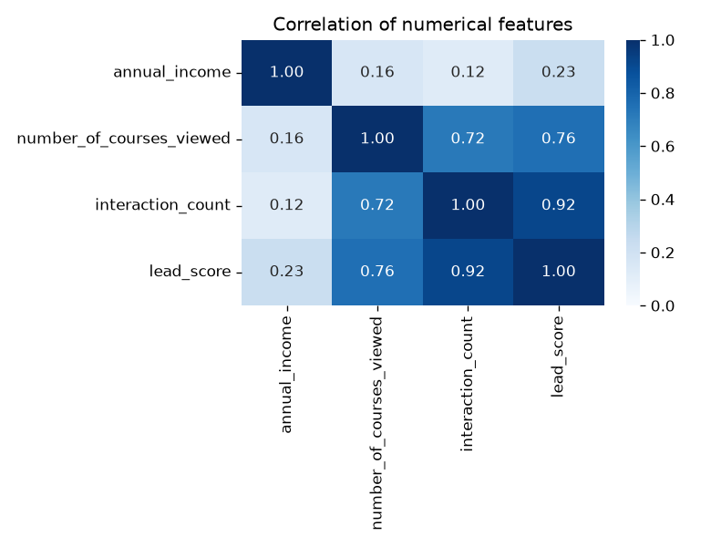
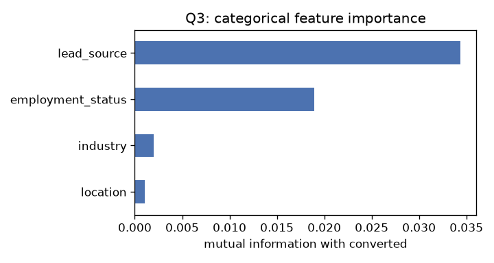
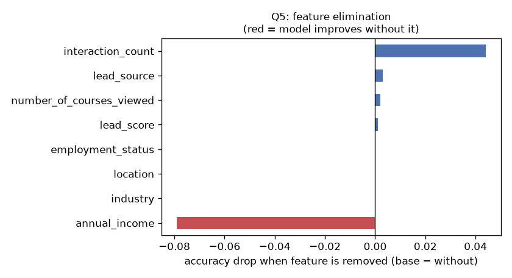
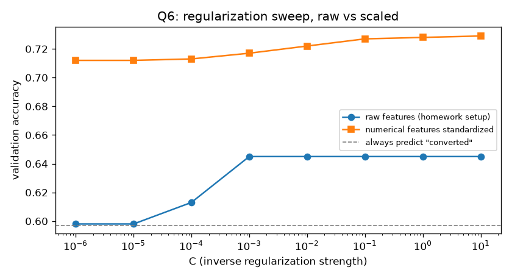

# Homework 3 Solution: Machine Learning for Classification (ML Zoomcamp 2026)

Predicting whether a lead **converts** (`converted`) on the pinned 2026
lead-scoring dataset (5,000 rows, 4 categorical + 4 numerical features) using
one-hot encoding (`DictVectorizer`) and scikit-learn's `LogisticRegression`.

## Answers

| # | Question | Answer | Evidence |
|---|----------|--------|----------|
| Q1 | Mode of `industry` | **`technology`** | 1,173 rows (retail 925, healthcare 840, `NA` 240) |
| Q2 | Biggest correlation | **`interaction_count` and `lead_score`** | r = 0.916 (courses/lead_score 0.757, courses/interactions 0.722, income/interactions 0.123) |
| Q3 | Biggest mutual information | **`lead_source`** | 0.03 (employment_status 0.02, industry 0.00, location 0.00) |
| Q4 | Validation accuracy | **0.65** | 0.645 |
| Q5 | Smallest difference on elimination | **`number_of_courses_viewed`** | 0.002 (lead_source 0.003, interaction_count 0.044) |
| Q6 | Best `C` | **0.001** | 1e-6 → 0.598, 1e-5 → 0.598, 1e-4 → 0.613, 1e-3 → 0.645 |

All six answers were also checked with the course's own validator
(`cohorts/2026/data/validate_homework.py::validate_hw3`), which passes.

## Files

| File | Purpose |
|------|---------|
| [homework3_solution.ipynb](homework3_solution.ipynb) | Executed notebook with EDA, all questions, plots and a scaling investigation |
| [homework3_solution.py](homework3_solution.py) | The same pipeline as a standalone script |
| [images/](images/) | Correlation heatmap, MI, feature-elimination and C-sweep plots |
| [deliverables/](deliverables/) | LinkedIn, X, Instagram and Medium posts, plus an FAQ proposal |

## Reproduce

```bash
# from this folder
pip install pandas scikit-learn matplotlib seaborn jupyter
python homework3_solution.py
jupyter notebook homework3_solution.ipynb
```

The script reads `cohorts/2026/data/course_lead_scoring_2026.csv` if it exists
locally, otherwise it downloads the CSV from the course repo.

## Technical notes

**Data preparation.** Six of nine columns have missing values (`annual_income`
7.4%, `industry` 4.8%, ...). Categorical gaps become the string `'NA'`, which
`DictVectorizer` treats as its own category; numerical gaps become `0.0`. The
target is 57.7% positive overall and 59.7% in the validation split, so the
majority-class baseline accuracy is about **0.60**.

**Q2.** `lead_score` is almost a function of engagement: r = 0.92 with
`interaction_count` and 0.76 with `number_of_courses_viewed`.



**Q3.** Only `lead_source` and `employment_status` carry any signal. `industry`
and `location` are essentially independent of conversion.



**Q5: the surprising result.** Removing `annual_income` *raises* validation
accuracy from 0.645 to **0.724**. The feature isn't harmful. It is unscaled:
income sits around 54,000 while every other column is between 0 and about 10.
liblinear's L2-penalised optimisation is not scale invariant, so this column
dominates. The fitted income weight even comes out *negative* (−4.6e-6), even
though converters earn more on average (54.6k vs 45.0k). The model predicts
"converted" for 87% of validation leads against an actual 60%.



**Q6 and the fix.** Small `C` means strong regularisation. At C ≤ 1e-5 the
weights collapse and accuracy falls to the baseline (0.598). If the four
numerical columns are standardised with `StandardScaler` (fit on train only),
accuracy rises to **0.728** at C=1 and stays above 0.71 at every C tested.
Using `np.log1p(annual_income)` instead gives 0.722.



**Takeaways**

1. Scale numerical features before logistic regression, especially when it is regularised.
2. A feature that seems to hurt in elimination may just be badly scaled. Check that before you drop it.
3. Compare against the majority-class baseline. The homework model's 0.645 is only about 5 points above it.
