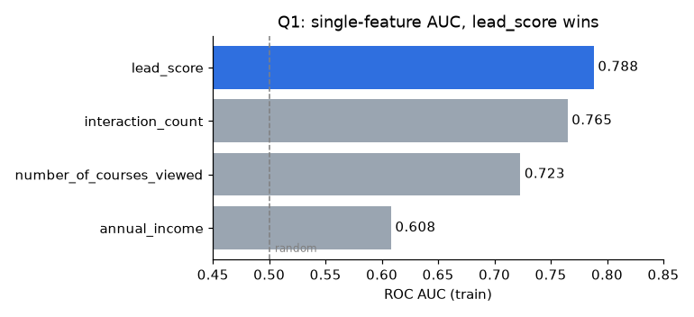
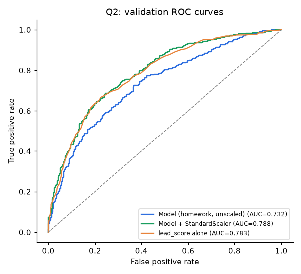
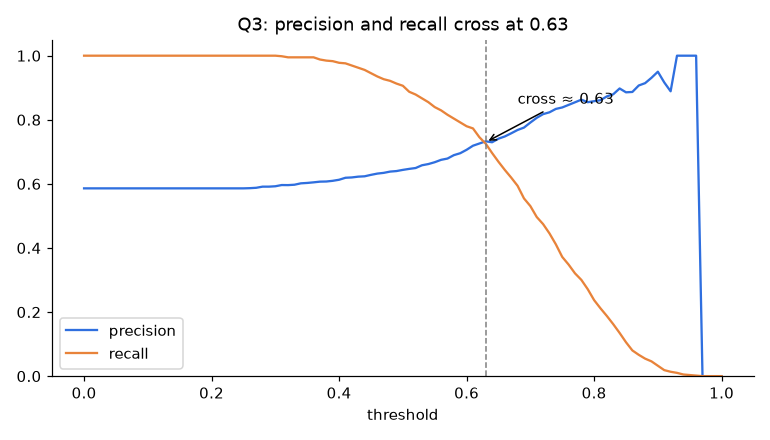
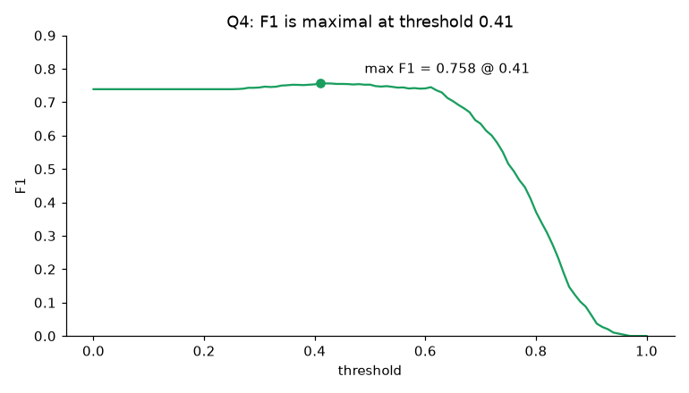
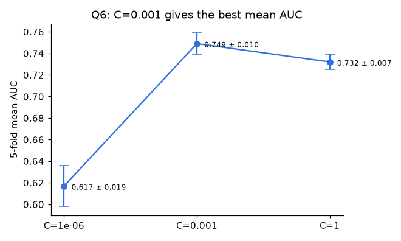

# My Model Lost to One of Its Own Features: Evaluation Lessons from ML Zoomcamp Week 4

*ROC AUC, precision, recall, F1 and cross-validation on a lead-conversion dataset, and the baseline check that caught a bug I would have missed.*

---

Accuracy tells you how often a model is right at one threshold. It doesn't tell you how well the model ranks, how it trades false positives for false negatives, or whether the score holds up on a different split. Week 4 of [ML Zoomcamp](https://github.com/DataTalksClub/machine-learning-zoomcamp) covers those gaps.

The task: predict whether a lead `converted` (signed up) from 8 features: 4 categorical (`lead_source`, `industry`, `employment_status`, `location`) and 4 numerical (`number_of_courses_viewed`, `annual_income`, `interaction_count`, `lead_score`). The dataset has 5,000 rows, split 60/20/20 with `random_state=1`. Missing categoricals are filled with `'NA'` and missing numericals with `0.0`.

## 1. ROC AUC works on raw features

ROC AUC answers one question: *if I pick a random positive and a random negative, how often does the positive get the higher score?* It only depends on ranking, so you can feed it a raw column without training anything:

```python
from sklearn.metrics import roc_auc_score

for c in numerical:
    auc = roc_auc_score(y_train, df_train[c])
    if auc < 0.5:                      # negatively related: flip it
        auc = roc_auc_score(y_train, -df_train[c])
    print(c, round(auc, 3))
```

| feature | AUC (train) |
|---|---|
| **lead_score** | **0.788** |
| interaction_count | 0.765 |
| number_of_courses_viewed | 0.723 |
| annual_income | 0.608 |

None of them needed flipping. `lead_score` is the strongest single signal. Remember this number.



## 2. The model that lost

Next, the standard pipeline: one-hot encoding with `DictVectorizer`, then `LogisticRegression(solver='liblinear', C=1.0, max_iter=1000)`.

```python
dv = DictVectorizer(sparse=False)
X_train = dv.fit_transform(df_train[features].to_dict(orient="records"))
model = LogisticRegression(solver="liblinear", C=1.0, max_iter=1000).fit(X_train, y_train)

y_pred = model.predict_proba(dv.transform(df_val[features].to_dict(orient="records")))[:, 1]
roc_auc_score(y_val, y_pred)   # 0.732
```

**0.732.** On the same validation set, `lead_score` alone scores **0.783**.

The model has `lead_score` as an input, plus seven more features, and it still ranks leads worse than that one column. Adding information shouldn't make a model worse, so something in the pipeline was wrong.

### The cause: scale

`annual_income` is around 50,000. Every other feature is between 0 and 10, and the one-hot columns are 0 or 1. sklearn's logistic regression applies an L2 penalty by default, and L2-regularized models are **not scale invariant**: the penalty treats one unit of weight the same for every feature, regardless of the feature's units.

The symptoms:
- `annual_income` weight ≈ **−0.00001**, negative even though converters tend to earn more
- the model predicts "converted" for **82%** of validation leads, while the true rate is **59%**

Standardizing the numeric columns, fitting the scaler on the training data only:

```python
scaler = StandardScaler().fit(df_train[numerical])
df_train[numerical] = scaler.transform(df_train[numerical])
df_val[numerical] = scaler.transform(df_val[numerical])
```

Validation AUC goes from **0.732 to 0.788**, finally beating the single-feature baseline.



> For the homework the answer is still 0.732, because the question specifies the unscaled pipeline. In a real project, this is the bug you want to catch.

## 3. Precision, recall, and choosing a threshold

AUC covers every threshold, but in production you have to choose one. For each threshold from 0 to 1 in steps of 0.01, I counted TP, FP and FN and computed:

- **precision** = TP / (TP + FP): of the leads we flag, how many convert?
- **recall** = TP / (TP + FN): of the leads that convert, how many do we flag?



At threshold 0 everyone is flagged, so recall is 1 and precision equals the base rate (0.586). As the threshold rises, precision climbs and recall falls. **They cross at 0.63** (P = 0.733, R = 0.725).

## 4. F1 doesn't peak where P = R

F1 is the harmonic mean, `2PR / (P + R)`. It's natural to expect it to peak where precision and recall are equal. It doesn't:



**Max F1 = 0.758 at threshold 0.41**, far from 0.63. With 59% positives, a low threshold keeps recall at 0.98 while precision only drops to 0.62. The harmonic mean prefers that to the balanced point.

So which threshold should you use? It depends on costs. If a sales call is cheap and a missed lead is expensive, choose a low threshold. If outreach is expensive, choose a high one. F1 is one reasonable default, not the right answer for every case.

## 5. Cross-validation: is 0.732 real?

A single validation split can be lucky. `KFold(n_splits=5, shuffle=True, random_state=1)` on the combined train+validation data gives:

```
fold AUCs: 0.731  0.730  0.736  0.741  0.721
mean 0.732, std 0.007
```

A standard deviation of 0.007 means the validation number was representative.

Then tuning `C` with the same folds:

| C | mean AUC | std |
|---|---|---|
| 0.000001 | 0.617 | 0.019 |
| **0.001** | **0.749** | 0.010 |
| 1 | 0.732 | 0.007 |



`C=0.001` wins. Strong regularization shrinks the weights, which limits how much the unscaled income column can distort the fit.

With scaled features, I reran the same sweep and **every C scored 0.792 ± 0.013**. Even `C=1e-6` matches, because AUC only cares about the order of the scores, and tiny weights still put leads in the right order. The "best C" in the unscaled run was caused by the scaling problem, not by a real difference in regularization.

## Takeaways

1. **Your best single feature is a free baseline.** Q1 gave me 0.788 before I trained anything. If the model can't beat that, check the preprocessing before tuning.
2. **Scale numeric features before regularized linear models.** A column in the tens of thousands can take over an L2-penalized fit.
3. **Choose the threshold based on costs.** P = R and max F1 gave thresholds 0.22 apart on the same model.
4. **Report mean ± std from cross-validation.** 0.732 ± 0.007 tells you more than 0.732.
5. **Question surprising hyperparameter results.** C=0.001 "winning" was a symptom of the scaling problem.

## Answers

| Q | Answer |
|---|---|
| 1. Highest single-feature AUC | `lead_score` |
| 2. Validation AUC | 0.732 |
| 3. P/R intersection | 0.63 |
| 4. Max-F1 threshold | 0.41 |
| 5. 5-fold CV std | 0.007 |
| 6. Best C | 0.001 |

Full code, executed notebook and plots: [github.com/devotuoma/machine-learning-zoomcamp — hw04-evaluation](https://github.com/devotuoma/machine-learning-zoomcamp/tree/hw04-evaluation/cohorts/2026/homework/04-evaluation/solution)

---

*Thanks to Alexey Grigorev and the DataTalks.Club community for ML Zoomcamp, a free course built around real projects. If you're following along, I'd like to hear what surprised you this week.*

*Tags: Machine Learning, Data Science, Model Evaluation, Python, Scikit Learn*
