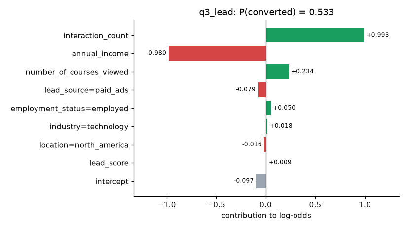
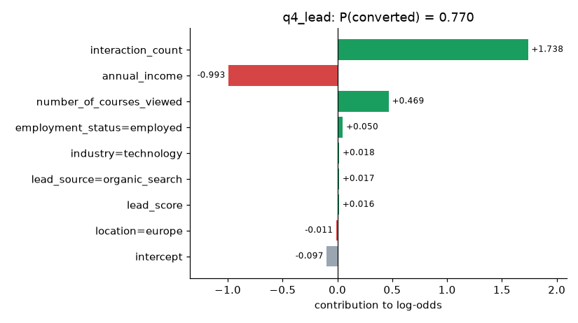
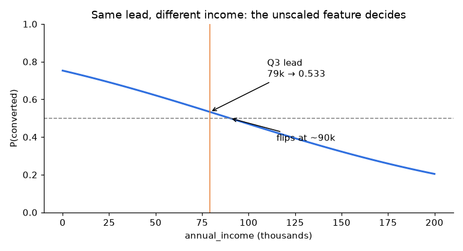

# Homework 5 — Deploying Machine Learning Models (2026)

Solution for [Homework 5](../homework.md) of ML Zoomcamp 2026. We take the frozen lead-scoring model (`pipeline.bin`: `DictVectorizer` + `LogisticRegression`), check it, load it, serve it with FastAPI, and run it in the course's Docker image. Then we test what the service does with awkward input.

## Files

| File | What it does |
|---|---|
| [q1_env_check.sh](q1_env_check.sh) | Q1: local `uv` version, pinned Python, Dockerfile `uv`, artifact hash |
| [q2_locked_version.py](q2_locked_version.py) | Q2: reads scikit-learn from `uv.lock` and `pyproject.toml` |
| [verify_artifact.py](verify_artifact.py) | Checks `pipeline.bin` against its SHA-256 before anything unpickles it |
| [q3_load_model.py](q3_load_model.py) | Q3: `pickle.load` + `normalize_record` + `predict_proba` |
| [q4_serve.sh](q4_serve.sh) / [q4_client.py](q4_client.py) | Q4: start uvicorn, call `/health` and `/predict` |
| [q5_dockerfile_base.py](q5_dockerfile_base.py) | Q5: parses the `FROM` line |
| [q6_container.sh](q6_container.sh) | Q6: build, run and query the container |
| [explain_prediction.py](explain_prediction.py) | Splits a prediction into per-feature log-odds contributions |
| [income_sensitivity.py](income_sensitivity.py) | What-if: same lead, income from 0 to 200k |
| [edge_cases.py](edge_cases.py) | Sends typos, unseen categories and bad numbers to the API |
| [solve_all.py](solve_all.py) | Writes every answer to [results/answers.json](results/answers.json) |
| [tests/](tests/) | 13 pytest checks, including a live uvicorn server |
| [Makefile](Makefile) | `make q3`, `make serve`, `make q4`, `make q6`, `make test`, … |
| [deliverables/](deliverables/) | Learning-in-public posts and FAQ proposal |

## Run it

```bash
cd cohorts/2026/homework/05-deployment
uv sync --locked                      # Python 3.11.15, scikit-learn 1.7.2
python3 solution/verify_artifact.py   # always before unpickling
uv run --locked python solution/q3_load_model.py

./solution/q4_serve.sh                # terminal 1
python3 solution/q4_client.py         # terminal 2

./solution/q6_container.sh            # Docker
uv run --locked --with pytest pytest solution/tests -q
```

## What I found beyond the answers

### 1. Why 0.533? Opening up the prediction

Logistic regression is a sum passed through a sigmoid, so every prediction splits exactly into one contribution per feature (`weight × value`). [explain_prediction.py](explain_prediction.py) does that, and a test checks it reproduces `predict_proba` to 1e-12.



`interaction_count` (+0.99) and `annual_income` (−0.98) almost cancel out. `lead_score`, the best single feature in Homework 4 (AUC 0.788), adds only **+0.009**. The pipeline has no scaler, so the model relies on raw income, the same problem Homework 3 and 4 showed in training, now in production.



### 2. A raise flips the decision

Keep the Q3 lead fixed and change only income:



| income | 0 | 55,051 (median) | 79,276 (Q3) | 100,000 | 200,000 |
|---|---|---|---|---|---|
| P(converted) | 0.753 | 0.606 | 0.533 | 0.469 | 0.204 |

The decision flips to "won't convert" at about 90k, although in the data converters earn *more* on average.

### 3. The API says 200 OK to almost anything

[edge_cases.py](edge_cases.py) against the running service ([results](results/edge_cases.json)):

| input change | status | P |
|---|---|---|
| none (Q3 lead) | 200 | 0.533 |
| `lead_source: "Paid_Ads"` (capital letters) | 200 | 0.553 |
| `lead_source: "tiktok"` (never seen) | 200 | 0.553 |
| `location: "North America"` | 200 | 0.537 |
| `annual_income: "79276"` (string) | 200 | 0.533 |
| `annual_income: 7927600` (typo ×100) | 200 | **0.000** |
| `interaction_count: -3` | 200 | 0.167 |
| `number_of_courses_viewed: 2.5` | **422** | — |
| `{}` (empty body) | 200 | 0.610 |

`DictVectorizer` silently drops category values it didn't see in training, so `"Paid_Ads"` and `"tiktok"` both become an all-zero `lead_source` block and get the same score. Pydantic validates **types**, not **values**: a string that parses as a number is fine, and a negative count or absurd income is fine. Only a fractional integer is rejected. For a real service I'd add `Literal[...]` types for the categories and `Field(ge=0)` bounds on the numbers.

### 4. Same answer everywhere

The pickled model, the uvicorn service and the container all return the same probability. That works because four things are pinned: the artifact (SHA-256), the lockfile (`uv sync --locked`), the Python version (`.python-version`) and the preprocessing (`normalize_record`, shared by the scripts and the API). The `uv` version itself (0.13.6 locally, 0.10.11 in the image) doesn't matter.
